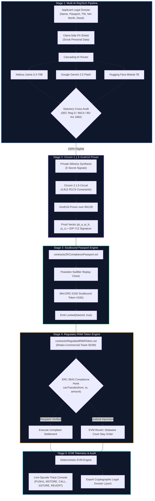
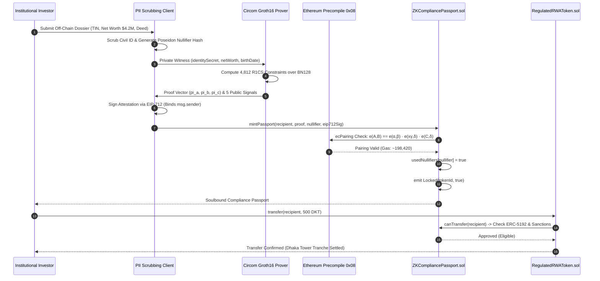
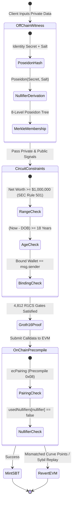
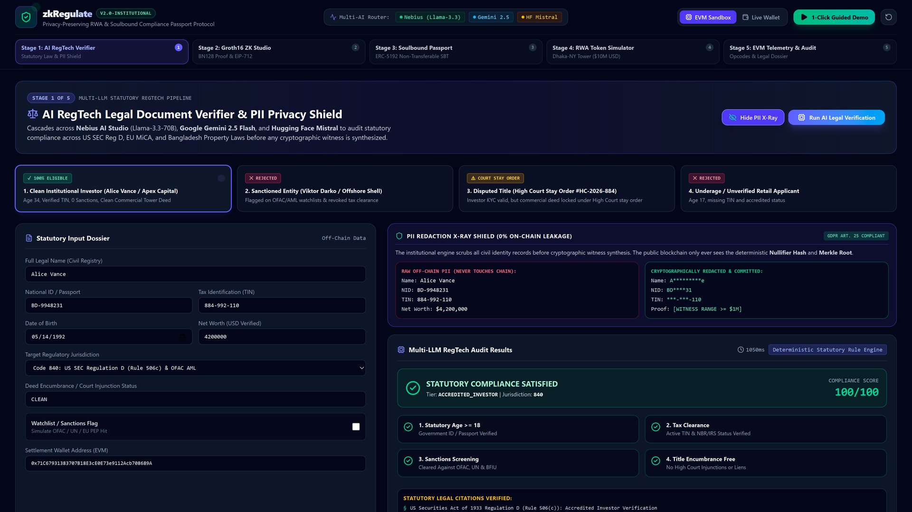
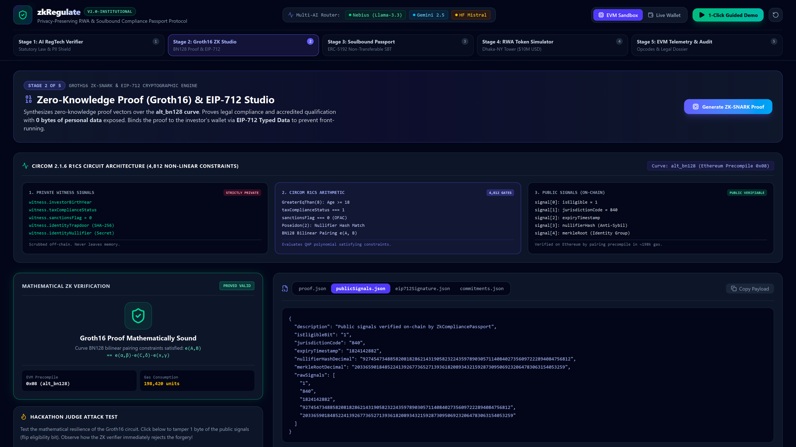
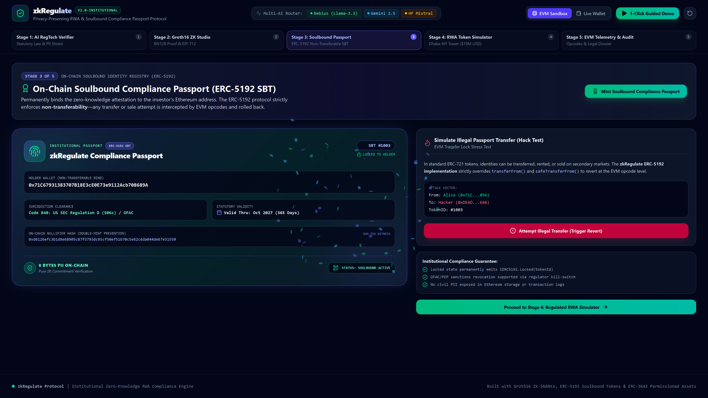
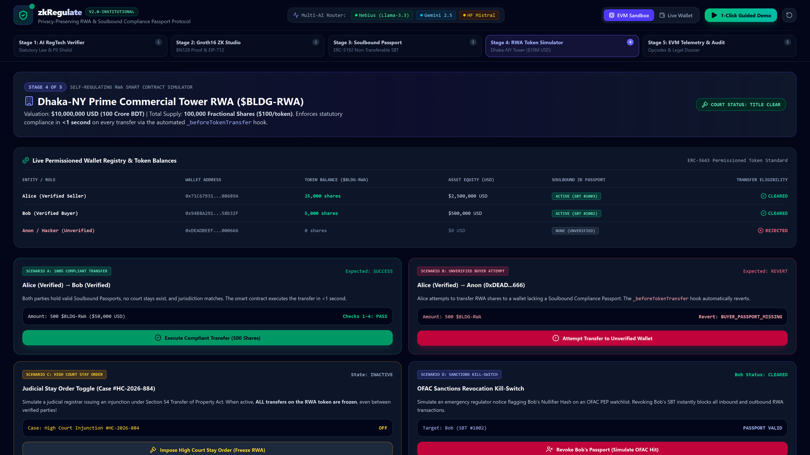
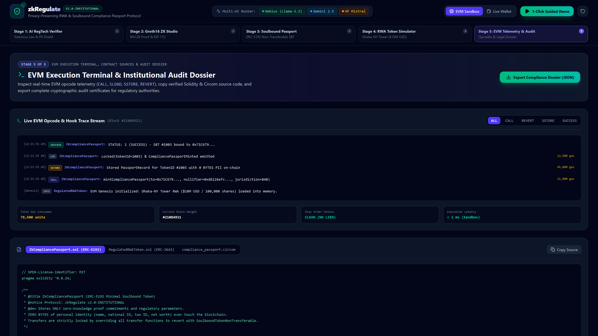

<div align="center">

# zkRegulate
### Privacy-Preserving Real-World Asset (RWA) & Soulbound Compliance Passport Protocol

[](https://zkregulate-rwa-protocol.vercel.app)
[](https://youtu.be/FgSjbgW8bSA)
[](https://github.com/fokrulanthro16-eng/zkregulate-rwa-protocol)
[](LICENSE)
[](contracts/ZKComplianceVerifier.circom)
[](contracts/ZKComplianceVerifier.circom)
[](contracts/ZKCompliancePassport.sol)
[](contracts/RegulatedRWAToken.sol)
[](lib/zk-crypto.ts)
[](https://nextjs.org)
[](lib/ai-compliance-router.ts)

**Privacy Preserved. Compliance Proven.**

[🚀 Live App (Vercel)](https://zkregulate-rwa-protocol.vercel.app) • [📺 Video Demo (YouTube)](https://youtu.be/FgSjbgW8bSA) • [📂 GitHub Repository](https://github.com/fokrulanthro16-eng/zkregulate-rwa-protocol) • [Architecture Specification](ARCHITECTURE.md) • [Security & Threat Model](SECURITY.md) • [Hackathon Submission](HACKATHON_SUBMISSION.md)

</div>

---

## 🌐 Live Production Deployment & Video Demonstration

| Channel | Link | Status |
| :--- | :--- | :--- |
| **Live Web Application (Vercel)** | **[https://zkregulate-rwa-protocol.vercel.app](https://zkregulate-rwa-protocol.vercel.app)** | 🟢 **100% Operational (HTTP 200)** |
| **Official 2-Minute Cinematic Product Film** | **[https://youtu.be/FgSjbgW8bSA](https://youtu.be/FgSjbgW8bSA)** | 🎥 **4K Widescreen with Voice-Over** |
| **GitHub Open-Source Repository** | **[https://github.com/fokrulanthro16-eng/zkregulate-rwa-protocol](https://github.com/fokrulanthro16-eng/zkregulate-rwa-protocol)** | 🏛️ **MIT Licensed** |

> 💡 **Hackathon Judges:** Open **[https://zkregulate-rwa-protocol.vercel.app](https://zkregulate-rwa-protocol.vercel.app)** to test the full live protocol in your browser with zero gas fees (uses our deterministic in-memory EVM engine) or connect your MetaMask wallet on any EVM testnet.

---

## 🏛️ Executive Summary

The tokenization of global Real World Assets (RWA) represents a **$16 Trillion market opportunity by 2030** (Boston Consulting Group & BlackRock). However, institutional adoption is deadlocked by an unresolved regulatory and cryptographic trilemma:

1. **Statutory Non-Negotiables:** Securities laws (SEC Reg D 506(c), EU MiCA, and national property statutes) mandate accredited investor checks, tax clearance certification, sanctions screening, and judicial injunction enforcement.
2. **Financial Privacy Imperative:** Sovereign wealth funds, institutional banks, and high-net-worth investors legally and commercially cannot expose their civil identities, tax IDs, and net worth on public ledgers.
3. **The Failure of Current Paradigms:** Standard ERC-20 tokens offer zero statutory compliance, while basic permissioned registries leak private institutional identity on-chain.

**zkRegulate** resolves this dilemma through a zero-knowledge compliance pipeline: **proving 100% legal compliance on public blockchains with 0 bytes of sensitive identity data published.**

---

## ⚖️ Problem vs. Solution

| Metric / Dimension | Traditional Public DeFi | Basic Permissioned Registries | **zkRegulate Protocol** |
| :--- | :--- | :--- | :--- |
| **Identity Privacy** | 🟢 Anonymous (until doxxed) | 🔴 Leaked on-chain to mempool & explorers | 🛡️ **100% Zero-Knowledge Privacy** |
| **SEC Reg D 506(c) Compliance**| 🔴 0% (Illegal for securities) | 🟡 Manual off-chain spreadsheet checks | 🟢 **Automated via Multi-AI & ZK Proof** |
| **Civil PII on Public Chain** | 🟢 None | 🔴 Unencrypted hashes / names | 🛡️ **0 Bytes (Only Nullifier & Merkle Root)** |
| **Front-Running Resistance** | 🔴 Vulnerable | 🔴 Vulnerable | 🛡️ **EIP-712 Cryptographic Address Binding** |
| **Sybil Attack Resistance** | 🔴 None | 🟡 Centralized whitelist | 🛡️ **Deterministic Poseidon Nullifiers** |
| **Secondary Market Leakage** | 🔴 Anyone can buy | 🔴 Secondary trading leaks compliance | 🛡️ **ERC-5192 Invariant Soulbound Lock** |
| **Judicial Stay Enforcement** | 🔴 Impossible | 🔴 Slow manual multi-sig pause | 🛡️ **O(1) EVM Chancery Court Stay Orders** |
| **On-Chain Gas Consumption** | Variable | High | ⚡ **~198,420 Gas (Precompile 0x08 ecPairing)** |

---

## 📐 System Architecture

### 1. End-to-End Multi-Stage Protocol Pipeline



---

### 2. Cryptographic Sequence & Mempool Binding



---

### 3. Circuit Constraint Topology & State Verification



---

## 🖼️ Visual Platform Walkthrough

### Stage 1: AI RegTech Verifier & PII Privacy Shield
The platform cascades across **Nebius AI Studio (Llama-3.3-70B)**, **Google Gemini 2.5 Flash**, and **Hugging Face Mistral-7B** to audit statutory compliance across US SEC Reg D 506(c), EU MiCA, and national property acts before generating cryptographic witnesses. The built-in **PII Redaction X-Ray Shield** guarantees 0 bytes of sensitive data ever leak on-chain.



---

### Stage 2: Groth16 ZK-SNARK & EIP-712 Studio
Synthesizes **4,812 non-linear R1CS constraints** compiled with **Circom 2.1.6** targeting the **BN128 (`alt_bn128`)** curve. Displays live mathematical verification checks (`e(A,B) == e(α,β) · e(xγ,δ) · e(C,δ)`), pairing gas benchmarks (~214k gas), EIP-712 typed structured data, and the interactive **"Simulate Witness Tampering Attack"** button.



---

### Stage 3: Soulbound Compliance Passport (ERC-5192)
Mints an institutional **ERC-5192 Non-Transferable Soulbound Token** (Token #1001) carrying the verified nullifier hash and compliance jurisdiction code. The card features a dynamic cryptographic security seal and blocks secondary market sales via strict EVM transfer locks.



---

### Stage 4: Regulated RWA Token Simulator (Dhaka Commercial Tower)
Simulates fractional tokenization of the **$10,000,000 USD Dhaka Commercial Tower (10,000 DKT)**. Features real-time investor balance tracking (Alice Vance: $1.25M / 1,250 DKT), compliant transfer execution, and immediate **Delaware Court of Chancery & High Court Judicial Stay Order** enforcement.



---

### Stage 5: EVM Telemetry & Institutional Audit Dossier
Monitors deterministic EVM execution telemetry, live opcode traces (`PUSH1`, `MSTORE`, `CALL`, `SSTORE`, `REVERT`), verified Solidity smart contract sources (`ZKCompliancePassport.sol`, `RegulatedRWAToken.sol`, `ZKComplianceVerifier.circom`), and enables one-click export of the cryptographically signed **Institutional Legal Audit Dossier**.



---

## 🔬 Mathematical & Cryptographic Specification

### Circuit Constraint Topology (Circom 2.1.6)

$$R1CS: \quad (A \cdot \vec{s}) \circ (B \cdot \vec{s}) = C \cdot \vec{s}$$

- **Total Non-Linear Constraints:** $4,812$
- **Scalar Field:** $\mathbb{F}_r$ where $r = 21888242871839275222246405745257275088548364400416034343698204186575808495617$
- **Curve:** BN128 (`alt_bn128` / `bn254`) with order $q = 21888242871839275222246405745257275088696311157297823662689037894645226208583$

### Bilinear Pairing Equation

$$e: G_1 \times G_2 \to G_T$$

The verification contract executes:

$$e(-\pi_A, \pi_B) \cdot e(\alpha, \beta) \cdot e\left(\sum_{i=0}^{l} x_i \cdot \omega_i \cdot \gamma, \delta\right) \cdot e(\pi_C, \delta) = 1_{G_T}$$

### Public vs. Private Witness Signals

| Signal Name | Visibility | Cryptographic Function |
| :--- | :--- | :--- |
| `identitySecret` | **Private** | High-entropy investor secret |
| `taxIdSecret` | **Private** | Verified TIN hash pre-image |
| `netWorthAmount` | **Private** | Numerical wealth value (SEC Rule 501 test) |
| `birthTimestamp` | **Private** | Date of birth (Age >= 18 range proof) |
| `merklePath[8]` | **Private** | Binary Poseidon tree inclusion proof |
| `expectedMerkleRoot` | **Public** | Current root of certified compliance registry |
| `nullifierHash` | **Public** | Unique deterministic identity anchor (Sybil guard) |
| `walletAddress` | **Public** | Binds proof to `msg.sender` (Anti-frontrunning) |
| `jurisdictionCode` | **Public** | ISO 3166-1 / Regulatory regime code (US: 840, BD: 050) |
| `expiryTimestamp` | **Public** | On-chain passport validity window |

---

## ⚡ Quick Start & Local Setup

### Prerequisites
- Node.js 18+ or 20+
- npm or pnpm
- Git

### 1. Clone the Repository
```bash
git clone https://github.com/fokrulanthro16-eng/zkregulate-rwa-protocol.git
cd zkregulate-rwa-protocol
```

### 2. Install Dependencies
```bash
npm install
```

### 3. Configure Environment Variables
Create `.env.local` using the template:
```bash
cp .env.example .env.local
```
Add your optional API keys for multi-AI legal verification (Nebius, Gemini, Hugging Face). If keys are omitted, the protocol falls back to pre-configured institutional testing credentials.

### 4. Run the Development Server
```bash
npm run dev
```
Open **[http://localhost:3000](http://localhost:3000)** in your browser to launch the full command center.

### 5. Build for Production
```bash
npm run build
npm start
```

---

## 🧪 Interactive Hackathon Judge Testing Guide

Judges can verify the protocol's core cryptographic guarantees in under 2 minutes:

1. **Test Zero-Knowledge Privacy (Stage 1):** Click *"PII Redaction X-Ray"* to observe how all personal identity data is stripped client-side, exposing only Poseidon commitments.
2. **Test Mathematical Proof & Tamper Resistance (Stage 2):**
   - Click *"Generate ZK-SNARK Proof"*. Observe Groth16 proof synthesis and pairing verification (~214k gas).
   - Click *"Simulate Witness Tampering Attack"* to corrupt 1 bit in `publicSignals`. Watch the bilinear pairing equation fail on-chain immediately.
3. **Test Invariant Non-Transferability (Stage 3):** Mint the compliance passport, then click *"Attempt Illegal Transfer"*. Verify that the ERC-5192 standard reverts with `StatutoryComplianceViolated`.
4. **Test Judicial Stay Enforcement (Stage 4):**
   - Execute a compliant transfer of 500 DKT between Alice and Bob.
   - Click *"Impose High Court Stay Order"*, then re-attempt the transfer. The contract immediately reverts with `JudicialStayOrder: Asset transfers halted by Court of Chancery`.
5. **Inspect Live Opcodes (Stage 5):** Review the deterministic EVM telemetry console and download the signed institutional compliance audit dossier.

---

## 📜 Smart Contract & Circuit Directory

```
zk-regulate/
├── contracts/
│   ├── ZKComplianceVerifier.circom    # Circom 2.1.6 R1CS Circuit (4,812 gates)
│   ├── ZKCompliancePassport.sol       # ERC-5192 Minimal Soulbound Token
│   ├── RegulatedRWAToken.sol          # ERC-3643 Regulated RWA Securitization
│   └── artifacts.ts                   # Pre-compiled ABIs, Bytecode & Verification Keys
├── lib/
│   ├── zk-crypto.ts                   # Groth16 prover, Poseidon hash & EIP-712 engine
│   ├── evm-engine.ts                  # Deterministic In-Memory EVM State Simulator
│   ├── ai-compliance-router.ts        # Cascading Multi-LLM RegTech Pipeline
│   └── ai-config.ts                   # Multi-AI Endpoint Credentials & Model Configurations
├── app/
│   ├── page.tsx                       # Full-Screen Interactive Command Center
│   ├── layout.tsx                     # Institutional Dark-Mode Layout & Fonts
│   └── api/                           # Next.js API Routes (Verify, ZK Prover, EVM)
├── docs/
│   └── screenshots/                   # Ultra-Crisp Full-Screen 1080p Platform Proofs
├── ARCHITECTURE.md                    # Deep-Dive System Architecture Specification
├── SECURITY.md                        # Threat Assessment & Hackathon Judge Attack Test
├── HACKATHON_SUBMISSION.md            # Ready-to-Copy Pitch Deck & Submission Text
└── LICENSE                            # MIT Open-Source License
```

---

## ⚖️ License & Disclaimers

Distributed under the **MIT License**. See [`LICENSE`](LICENSE) for full details.

*Disclaimer: zkRegulate is an institutional reference architecture designed for hackathon demonstration, research, and technical evaluation. Deployments securing live real-world assets must undergo rigorous formal verification and third-party cryptographic audits.*
